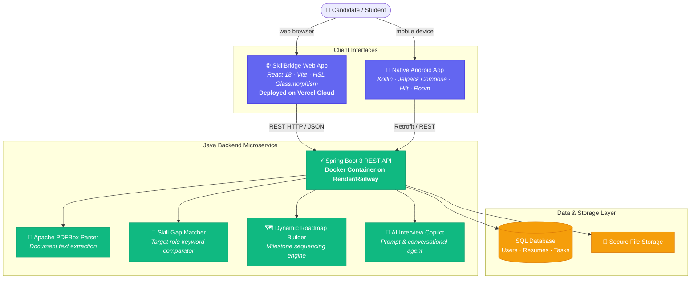
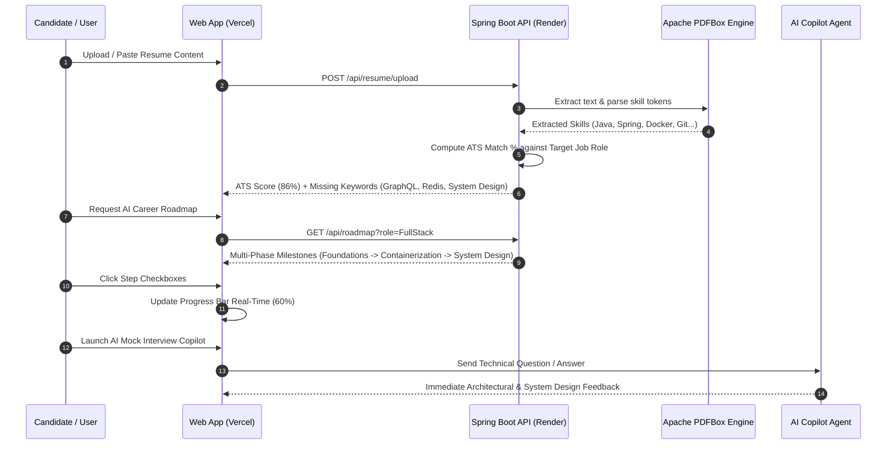

<div align="center">

# SkillBridge

### An AI-powered career roadmap & skill acceleration platform that analyzes resumes, detects ATS skill gaps, generates dynamic career pathways, and conducts interactive AI mock interviews — in seconds.

[](https://skillbridge-app.vercel.app)
[](https://vercel.com/akillesh2006s-projects)
[](https://render.com)

[](https://reactjs.org)
[](https://vitejs.dev)
[](https://www.oracle.com/java/)
[](https://spring.io/projects/spring-boot)
[](https://developer.android.com)
[](https://www.docker.com/)
[](./LICENSE)

</div>

---

> ## 🚀 Quick Links & Live Demonstrations
>
> - **🌐 Live Web App (Vercel)**: [https://skillbridge-app.vercel.app](https://skillbridge-app.vercel.app)
> - **☁️ Vercel Projects Dashboard**: [https://vercel.com/akillesh2006s-projects](https://vercel.com/akillesh2006s-projects)
> - **📦 GitHub Repository**: [https://github.com/Akillesh2006/SkillBridge](https://github.com/Akillesh2006/SkillBridge)

---

## 🎯 The problem

Millions of aspiring developers, engineers, and career switchers struggle to land tech roles due to unoptimized resumes, hidden ATS (Applicant Tracking System) rejections, and unclear learning pathways. 

- **ATS Rejection Loop**: Resumes fail initial automated screeners due to missing target keywords and metrics.
- **Fragmented Roadmaps**: Self-learners spend hours hunting for structured, role-specific learning steps.
- **Lack of Realistic Practice**: Candidates enter technical interviews without actionable feedback on system design or coding concepts.

**SkillBridge** solves this with an end-to-end AI acceleration platform combining automated resume parsing, ATS scoring, dynamic career roadmap generation, competency quizzes, and an AI mock interview copilot.

---

## ✨ What makes it different

Key architectural innovations built into SkillBridge:

| | Innovation | Why it matters |
|---|---|---|
| 📄 | **Graph & PDF Keyword Extractor** — Apache PDFBox + LLM parsing | Extracts verified technical skills directly from resumes and compares them against target job profile requirements with zero manual input. |
| 🗺️ | **Dynamic Milestone Roadmap Visualizer** | Transforms target job roles (*Full Stack, Android, AI/ML, Cloud Architect*) into multi-phase milestone paths with real-time percentage tracking. |
| 🎯 | **Competency Assessment Engine** | Interactive technical quizzes that score system architecture readiness and provide immediate explanatory feedback. |
| 🤖 | **AI Mock Interview Copilot** | Conversational technical assistant that conducts realistic interview simulations, reviews architecture choices, and offers ATS resume optimization tips. |

---

## 🏗️ Architecture



---

## 🔁 User & Execution Sequence

Trace of a candidate preparing for a **Full Stack Java + React Engineer** position:



---

## 💻 Tech Stack Overview

### 1. Web Application (`/web`)
- **Framework**: React 18 with Vite 5
- **Styling**: Custom Glassmorphism UI Design System with HSL tailwinds & Outfit/Inter typography
- **Icons & Visuals**: Lucide Icons & Responsive Grid layout
- **Deployment**: **Vercel Cloud** (`vercel.json` SPA build configuration)

### 2. Backend API (`/Backend/skillbridge-backend`)
- **Framework**: Java 17 with Spring Boot 3.x
- **Parsing**: Apache PDFBox for PDF resume document extraction
- **Security & Auth**: Spring Security with JWT (JSON Web Tokens)
- **Containerization**: Multi-stage `Dockerfile` ready for Render / Railway / Fly.io

### 3. Native Android App (`/app`)
- **Language & Framework**: Kotlin with Jetpack Compose
- **Architecture**: MVVM Clean Architecture
- **Dependency Injection**: Dagger Hilt
- **Networking**: Retrofit 2 + OkHttp 3

---

## 🛠️ Quick Start & Local Setup

### Prerequisites
- **Node.js** v18+ and `npm`
- **JDK 17+** and Maven
- **Android Studio** (for mobile app compilation)

### 1. Run Web Application (Vite / React)
```bash
# Navigate to web directory
cd web

# Install dependencies
npm install

# Start development server
npm run dev
# 🚀 Web app running at http://localhost:3000
```

### 2. Run Java Spring Boot Backend
```bash
# Navigate to backend directory
cd Backend/skillbridge-backend

# Build & run Spring Boot application
./mvnw spring-boot:run
# ⚡ REST API active at http://localhost:8080
```

### 3. Run with Docker
```bash
cd Backend/skillbridge-backend
docker build -t skillbridge-backend .
docker run -p 8080:8080 skillbridge-backend
```

---

## ⚡ 1-Click Cloud Deployment

### Deploy Web App to Vercel
Click the button below to deploy your own instance of SkillBridge to Vercel:

[](https://vercel.com/new/clone?repository-url=https%3A%2F%2Fgithub.com%2FAkillesh2006%2FSkillBridge)

Or import this repository directly in your [Vercel Dashboard](https://vercel.com/akillesh2006s-projects):
1. Go to [https://vercel.com/new](https://vercel.com/new).
2. Connect your GitHub repository **`Akillesh2006/SkillBridge`**.
3. Vercel automatically detects `vercel.json` and builds the `/web` frontend!

### Deploy Backend to Render
[](https://render.com/deploy?repo=https://github.com/Akillesh2006/SkillBridge)

---

## 📁 Repository Structure

```
SkillBridge/
├── README.md                      # Primary GitHub README (CivicMesh inspired layout)
├── vercel.json                    # Root Vercel cloud deployment routing
├── render.yaml                    # Render 1-click Docker backend deployment
├── web/                           # SkillBridge Web Application (Vite/React)
│   ├── index.html
│   ├── package.json
│   ├── vite.config.js
│   ├── vercel.json
│   └── src/
│       ├── App.jsx                # Feature-complete SkillBridge web dashboard
│       ├── main.jsx
│       └── index.css              # Custom Glassmorphism design system
├── Backend/                       # Java 17 Spring Boot Backend API
│   └── skillbridge-backend/
│       ├── Dockerfile
│       ├── pom.xml
│       └── src/main/java/com/skillbridge/
└── app/                           # Native Android Application (Kotlin)
    ├── build.gradle.kts
    └── src/main/
```

---

## 📄 License

Created by **[Akillesh K P](https://github.com/Akillesh2006)**. Distributed under the **MIT License**.
