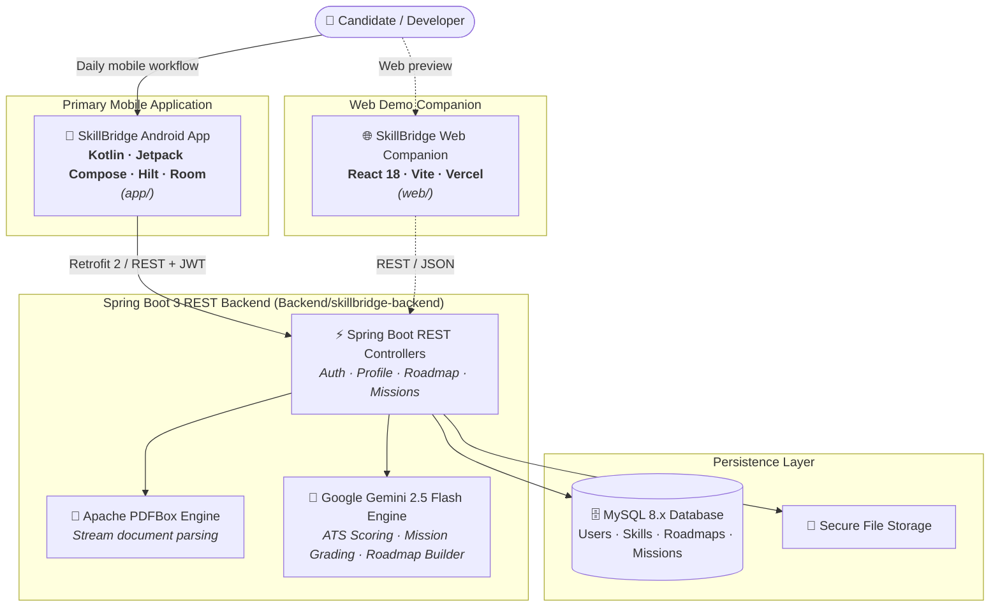
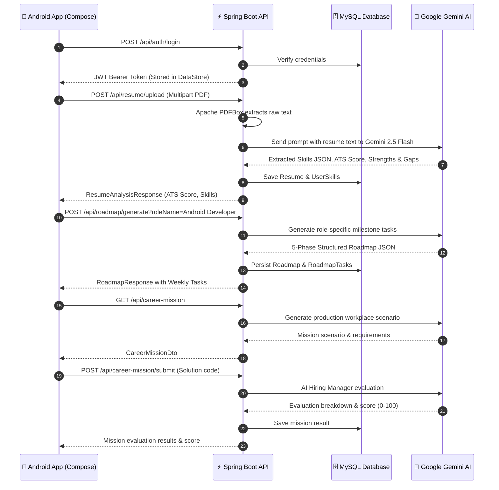

# 🚀 SkillBridge AI — Autonomous Career Roadmap & Skill Acceleration Platform

<div align="center">

[](app/)
[](app/)
[](app/)
[](Backend/skillbridge-backend/)
[](Backend/skillbridge-backend/)
[](Backend/skillbridge-backend/)

**An end-to-end, AI-powered career roadmap and skill acceleration ecosystem.**  
*Native Android Mobile Client + Java Spring Boot 3 Microservices Backend + Google Gemini AI.*

[📱 Native Android App](#-native-android-application-primary) • [⚡ Spring Boot Backend](#-spring-boot-backend-service) • [🌐 Web Companion](#-web-frontend-companion) • [🏗️ Architecture](#️-system-architecture) • [🚀 Quick Start](#-quick-start--setup)

</div>

---

## 📌 Project Overview & Structure

SkillBridge AI is fundamentally a **Native Android Mobile Application** designed to empower developers and students to bridge the gap between academic learning and industry job expectations.

### Preferred Logical Organization

```
SkillBridge/
├── app/                       # [PRIMARY] Native Android App (Kotlin + Jetpack Compose)
├── Backend/
│   └── skillbridge-backend/   # Java 21 / Spring Boot 3 REST API & MySQL Backend
├── web/                       # Separate Vite + React Web Demo (Deployed on Vercel)
├── gradle/                    # Gradle Wrapper and Version Catalog (libs.versions.toml)
├── build.gradle.kts           # Root Android Gradle Build File
├── settings.gradle.kts        # Root Gradle Settings (Module :app)
├── local.properties           # Local Android SDK configuration
├── vercel.json                # Vercel Deployment for /web
├── render.yaml                # Render Cloud Deployment for Spring Boot Docker Backend
└── README.md                  # Project Documentation
```

---

## 📱 Native Android Application (Primary)

The native Android app is the primary production interface for SkillBridge AI. It delivers a fluid, dark-mode glassmorphic user experience powered by **Kotlin 2.0** and **Jetpack Compose**.

### Key Mobile Capabilities
1. **📄 ATS Resume Scanner**: Select PDF resumes directly from Google Drive, Downloads, or Local Files with background chunk streaming, extracting verified skills and calculating real-time ATS match scores.
2. **🗺️ Interactive Weekly Learning Roadmap**: Dynamic, milestone-driven curriculum tailored to candidate target roles (Android, Java Backend, Full Stack, Data Science, AI/ML, DevOps). Includes task checkboxes, module completion toggles, and direct learning resource links.
3. **🚀 AI Career Project Mission Simulator**: Real-world workplace scenario simulator placing candidates in simulated production incidents and software engineering challenges evaluated by an AI Hiring Manager.
4. **🎯 Real-Time Skill Gap Radar**: Instant visual comparison between user extracted competencies and industry target job profiles.
5. **⚡ Daily Problem Challenges**: Daily technical challenges with automated AI grading and immediate actionable feedback.
6. **🤖 AI Mock Interview Copilot**: Realistic, multi-turn technical interview simulator evaluating system architecture, data structures, and algorithmic choices.
7. **📊 Career Readiness Analytics**: In-depth readiness scoring, progress analytics, and candidate diagnostic reports.
8. **🔔 Background WorkManager Notifications**: Periodic notification worker checking for daily milestones and missed challenges.

### Android Architecture & Tech Stack
- **Language**: Kotlin 2.0.21
- **UI Framework**: Jetpack Compose + Material 3 (BOM 2024.12.01)
- **Architecture**: MVVM Clean Architecture with `UiState<T>` Unidirectional Data Flow
- **Dependency Injection**: Dagger Hilt 2.52
- **Networking**: Retrofit 2.11.0 + OkHttp 4.12.0 + Kotlinx Serialization
- **Local Persistence**: Jetpack DataStore Preferences + Room 2.6.1 SQLite
- **Background Tasks**: AndroidX WorkManager 2.9.0

---

## ⚡ Spring Boot Backend Service

The core intelligence and persistence engine of SkillBridge AI, located in `Backend/skillbridge-backend/`.

### Key Backend Features
- **Document Text Extraction**: Apache PDFBox 3.0 stream processing for resume PDFs.
- **Google Gemini AI Integration**: Direct integration via `com.google.genai` (`gemini-2.5-flash`) for resume parsing, roadmap generation, daily challenges, and career missions.
- **Stateless Authentication**: Spring Security 6 with JJWT Bearer tokens.
- **MySQL 8 Database**: 13 JPA entities modeling users, resumes, roadmaps, tasks, career missions, and interview assessments.
- **Multi-Stage Docker Packaging**: Lightweight production Alpine container (`eclipse-temurin:21-jre-alpine`).

---

## 🌐 Web Frontend Companion

A standalone web application built with **React 18 + Vite** located in `/web`.
- Maintained as an independent web companion / interactive demo.
- Deployed on Vercel Cloud at `https://skillbridge-app.vercel.app`.
- Runs independently without interfering with the native Android Gradle project.

---

## 🏗️ System Architecture



---

## 🔁 Complete Application Execution Flow



---

## 🚀 Quick Start & Setup

### 1. Build and Run the Android Application (Primary)
Open the root directory `SkillBridge` in **Android Studio Ladybug / Meerkat** (or higher).

**Build via Gradle:**
```powershell
# In PowerShell:
$env:JAVA_HOME = "C:\Program Files\Android\Android Studio\jbr"
$env:PATH = "$env:JAVA_HOME\bin;$env:PATH"

.\gradlew.bat assembleDebug
```
The compiled APK will be generated at:
`app/build/outputs/apk/debug/app-debug.apk`

### 2. Run the Spring Boot Backend
Ensure MySQL is running with database `skillbridge_db`.
```powershell
cd Backend/skillbridge-backend
.\mvnw.cmd spring-boot:run
```
Backend runs at `http://localhost:8080/`.

### 3. Run the Web Companion
```bash
cd web
npm install
npm run dev
```
Web app runs at `http://localhost:3000/`.

---

## 📄 License & Credits
Developed by **Akillesh K P** ([@Akillesh2006](https://github.com/Akillesh2006)).  
Distributed under the MIT License.
